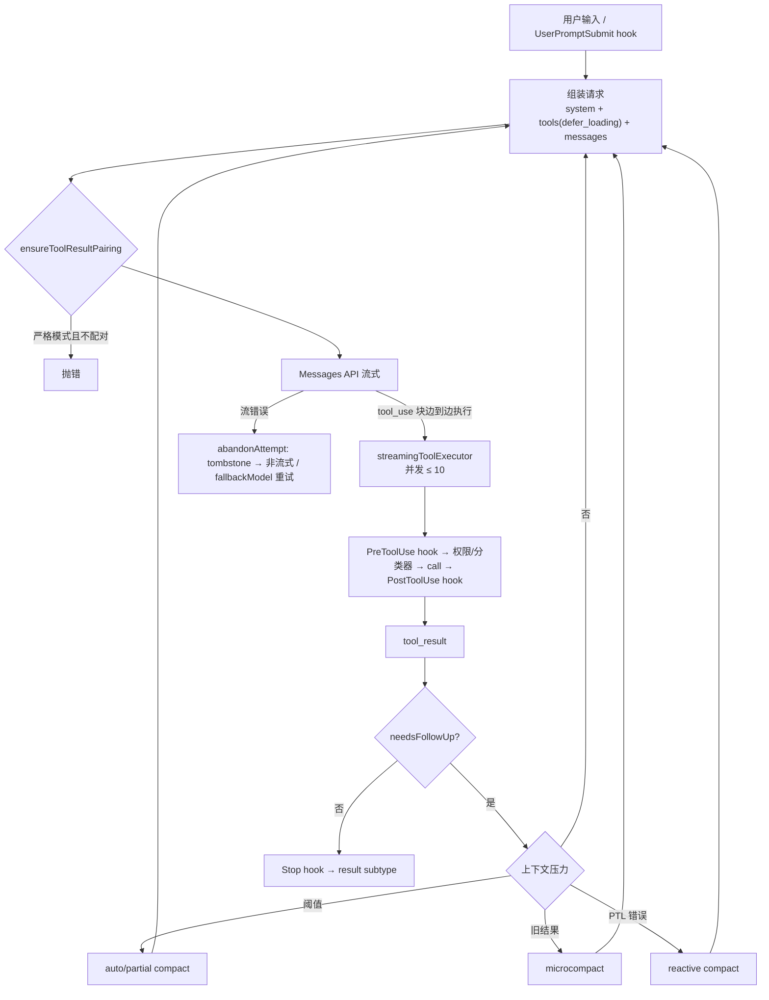

# 03 · 主循环、流式工具执行与上下文管理

## 1. 一轮“尝试”的状态

主循环每发一次模型请求，就新建一个尝试状态对象（**观测**，`chunk-27h4st9h.js`）。它的字段直接说明了循环在跟踪什么：

| 字段 | 含义 |
|------|------|
| `assistantMessages` | 本轮流式收到的 assistant 消息 |
| `toolUseBlocks` | 从中挑出的、还没有结果的 `tool_use` 块 |
| `toolResults` | 已产出的 `tool_result` |
| `toolDurations` | 每个工具的耗时 |
| `needsFollowUp` | 产生了工具调用，需要再发一轮 |
| `toolRequestedEndTurn` | 某个工具要求结束本轮（如 EndConversation） |
| `shouldPreventContinuation` | 阻止继续（如 Stop hook 或权限拒绝） |
| `toolWasDeferred` | 有工具被延迟或挂起（如等待用户审批） |
| `streamingToolExecutor` | 本轮的流式工具执行器，可 `rebuildStreamingToolExecutor()` 重建 |

还有两个方法：

- `reset({clearAssistantMessages})`：清空本轮所有累积内容。
- `abandonAttempt()`：放弃本轮。它先把已产出的每条 assistant 消息和每条工具结果都以 `{type:"tombstone"}` 的形式再 yield 一次，通知 UI 和记录器撤回；然后重建执行器。这用于流式出错后**回退到非流式**或**换备用模型重试**（相关事件 `tengu_streaming_fallback_to_non_streaming`、`fallbackModel`）。

**学到的设计**：流式输出已经展示给用户、也可能已经开始执行工具，要撤回就不能简单丢弃，必须显式发墓碑。

## 2. 流式工具执行

```text
收到流式 assistant 消息
  └─ 取出 content 里 type==="tool_use" 且还没有结果的块
       └─ streamingToolExecutor.addTool(block, message)   ← 边收边执行
  └─ needsFollowUp = true
UI 同步：set_in_progress_tool_use_ids（add / remove）
```

- 工具在**流还没结束时**就开始执行，不等 `message_stop`（**观测**：添加工具的函数在收到每条消息时调用）。
- 并发由 `isConcurrencySafe(input)` 和 `CLAUDE_CODE_MAX_TOOL_USE_CONCURRENCY`（默认 10）控制（见 02 文档）。
- 流本身有“看门狗”：`CLAUDE_STREAM_IDLE_TIMEOUT_MS`、`CLAUDE_ENABLE_STREAM_WATCHDOG`、`CLAUDE_BYTE_STREAM_IDLE_TIMEOUT_MS`。对应事件有 `tengu_streaming_stall`、`tengu_streaming_idle_timeout`、`tengu_streaming_watchdog_retry`、`tengu_streaming_stale_connection_retry`。

## 3. tool_use / tool_result 配对守卫

`ensureToolResultPairing`（**观测**，函数名保留在报错文案里）在每次发请求前检查消息历史：

- **严格模式**：发现不配对就直接抛错，文案大意是“拒绝修复，否则会把合成的占位内容注入模型上下文”，并附上消息结构摘要。
- **非严格模式**：补齐缺失的 `tool_result`，然后上报 `tengu_tool_result_pairing_repaired`（带 `messageCount` / `repairedMessageCount` / `messageTypes`）。

**学到的设计**：修复和暴露问题之间有取舍。生产环境默认修复以保可用，严格模式（测试 / 内部）宁可失败，也不让伪造内容悄悄进入上下文。

## 4. 结束条件（SDK 结果子类型）

`-p` / SDK 模式下，`result` 消息的 `subtype`（**观测**）：

| subtype | 触发 |
|---------|------|
| `success` | 正常结束 |
| `error_max_turns` | 超过 `maxTurns` |
| `error_max_budget_usd` | 超过 `--max-budget-usd` |
| `error_max_structured_output_retries` | `--json-schema` 结构化输出重试用尽 |
| `error_during_execution` | 运行时异常 |

Stop hook 可以阻止结束、让循环继续。为防死循环，再次触发时会带 `stop_hook_active` 标记（**观测**：标识符存在；具体判定逻辑没有展开）。

## 5. 上下文管理：不止一种“压缩”

| 机制 | 证据（观测） | 作用（推断） |
|------|------|------|
| **Auto-compact** | `CLAUDE_AUTOCOMPACT_PCT_OVERRIDE`、`CLAUDE_CODE_AUTO_COMPACT_WINDOW`、`DISABLE_AUTO_COMPACT`、`tengu_auto_compact_succeeded` | token 超过阈值时主动总结。阈值 = 有效窗口 − 总结缓冲，可用百分比覆盖压低 |
| **熔断** | `tengu_auto_compact_circuit_breaker`、`tengu_auto_compact_rapid_refill_breaker` | 压缩后很快又满了，就停止反复压缩 |
| **Reactive 模式** | `tengu_auto_compact_routed_reactive`、`tengu_compact_after_prompt_too_long`、`tengu_compact_ptl_retry` | 不主动压缩，等 API 返回 prompt-too-long 再压缩重试 |
| **Microcompact** | `tengu_time_based_microcompact`（带 `toolsCleared` / `toolsKept` / `keepRecent` / `tokensSaved`），`retry:context-hint` | 不做总结，只清掉较早的工具结果、保留最近 N 个；请求出错时也会用它腾空间后重试 |
| **Idle compact** | `CLAUDE_CODE_IDLE_COMPACT_MIN_TOKENS`、`tengu_idle_compact_fired` | 会话空闲时趁机压缩，不占用户的等待时间 |
| **Sleep compact** | `CLAUDE_CODE_SLEEP_COMPACT`、`CLAUDE_CODE_SLEEP_COMPACT_AFTER_MS` | 长时间离开后再压缩 |
| **Partial compact** | `tengu_partial_compact` | 只压缩历史的一段 |
| **压缩后恢复文件** | `tengu_post_compact_file_restore_success/_error` | 压缩后把最近读过的文件内容重新放回上下文 |
| **压缩缓存共享** | `tengu_compact_cache_sharing_success/_fallback`、`tengu_compact_cache_prefix` | 让总结请求复用主对话的 prompt cache 前缀，降低压缩本身的成本 |
| **Hook 接管** | `tengu_compact_replaced_by_hook`、`PreCompact` / `PostCompact` | 用户 hook 可以替换压缩结果 |
| **API 侧上下文编辑** | `clear_tool_uses_20250919`、`clear_thinking_20251015`、`compact_20260112` | 由服务端清理旧工具结果、旧 thinking，或做服务端压缩 |

消息流里用 `type:"system"`、`subtype:"compact_boundary"` 标记压缩边界；扫描历史时遇到 `compact_boundary` 或 `microcompact_boundary` 就停（**观测**）。

## 6. 旁路查询（querySource）

主对话以外，harness 还会发很多“小请求”，每个都带 `querySource` 标签（**观测**，34 种，完整列表见 [`evidence/query-sources.txt`](../evidence/query-sources.txt)）：

| 类别 | querySource |
|------|-------------|
| 会话管理 | `generate_session_title`、`rename_generate_name`、`agent_namer`、`away_summary`、`agent_summary`、`resume_cache_warm` |
| 记忆 | `extract_memories`、`extract_memories_first_look`、`auto_dream` |
| 安全 / 自动模式 | `auto_mode`、`auto_mode_critique`、`auto_mode_setup_propose`、`agent_classifier`、`subagent_config_classifier` |
| 工具辅助 | `web_search_tool`、`web_fetch_apply`、`tool_use_summary_generation`、`mcp_datetime_parse` |
| Hook | `hook_prompt`、`hook_agent` |
| 压缩 | `compact` |
| 交互增强 | `prompt_suggestion`、`side_question`、`insights`、`feedback` |
| Artifact 评论 | `artifact_comment_triage`、`artifact_comment_analyst`、`artifact_comment_reply`、`artifact_comment_fast_ack` |
| 插件评测 | `plugin_eval_judge`、`plugin_eval_mock` |
| 其他 | `sdk`、`agent:custom`、`model_validation` |

**学到的设计**：一个成熟的 agent 产品，模型调用远不止“主对话 + 工具”。标题、摘要、记忆、安全分类、自我批评都是单独的调用，各自用 `querySource` 打标签，便于分别计费、限流和观测。

## 7. 一张图


